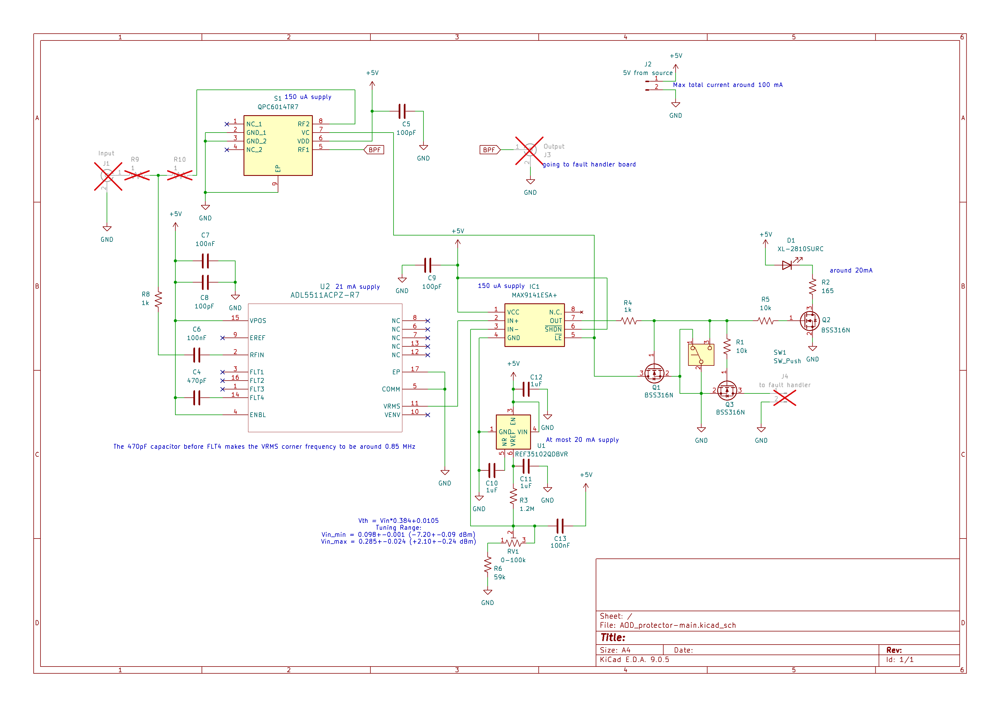
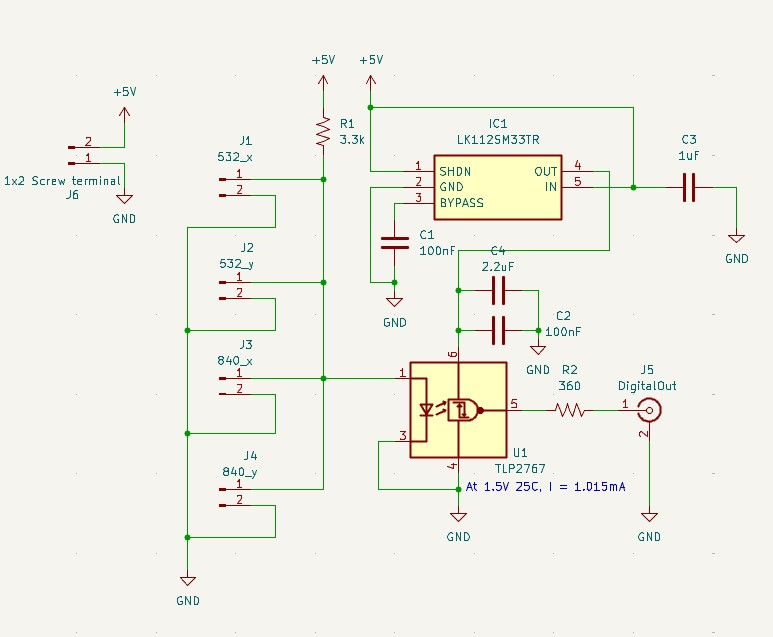

# AOD Protector
The protection circuit for the acousto-optic deflectors used for tweezers.

This KiCad project contains the following parts:

- [Main board](#main-board) (`AOD_protector-main`): the main board detecting and thresholding a single-channel rf signal
- [Fault handler](#fault-handler) (`AOD_protector-fault_handler`): a board to output a LVTTL flag to indicate a triggered incident
- [Power board](#power-board) (`AOD_protector-power_board`): the power regulating and distributing board (used in company with a switching AC-DC block)
- (optional) [Bandpass filter](#bandpass-filter-optional) (`AOD_protector-BPF_testboard`): bandpass filters to restrict the signal within a designated spectral band

Additionally, we made a custom CNC design based on Cheval's HS19AL1UD2 rack mount box. The design files can be found under `rack-mount_box`.

## Main board
The board is designed to implement an rf switch controlled by a power detector so the circuit is broken when the rf power is above a threshold. The input signal goes through a sampling circuit and enters the rf switch (QPC6014TR7) before going to the output.

The sampling circuit diverts $3.85~\%$ of the total power into the detection chip (ADL5511ACPZ-R7) which has a $250~\Omega$ input impedance. For low frequency (\~ $100\textrm{ MHz}$) signals, the $V_{rms}$ output of the chip is $V_{rms}=1.92\overline{V_{in}}+11\textrm{ mV}$. The $\overline{V_{in}}$ is the averaged voltage of the input low-pass filtered over a corner frequency determined by the capacitor connected to pin `FLT4`: $f_{LP}=1/(800 \pi\ \Omega~(C_{FLT4}+20\textrm{ pF}))$. In our case with $C_{FLT4}=470\textrm{ pF}$, $f_{LP}=812\textrm{ kHz}$.

The output of the chip is fed into a comparator (MAX9141ESA+) whose inverting input is set by a voltage reference and a variable voltage divider. With all the components taken into consideration, we have $V_{th}\ge0.384\overline{V_{in}}+10.5\textrm{ mV}$, and the trimpot should allow us to tune the threshold of the rf power from $-7\textrm{ dBm}$ to $2\textrm{ dBm}$ measured at the power divider. The remaining circuit and the rf switch will contribute an additional insertion loss of around $0.8\textrm{ dB}$ at low rf frequency. It is worth noting that the estimated total insertion loss is around $0.98\textrm{ dB}$.

When the voltage goes beyond the threshold, the comparator will engage a latch, disable the rf switch, send a flag to the fault-handler board, and turn on the on-board red LED. The status of the comparator can be reset by the pushbutton manually.

### *Change the threshold range*
The threshold's dynamic range can be adjusted by changing the resistors R3, R6, and the potentiometer RV1. The three resistors together form a voltage divider that outputs the desired $V_{th}$ from the $1.024~\textrm{V}$ voltage reference.

Together with the discussion about the rf power, $V_{th}$, and insertion loss in the previous paragraphs, the rf power threshold measured at the output port in dBm can be derived as follows:

$$20\log_{10}\left(10.24\frac{R_6+RV_1}{R_3+R_6+RV_1}-0.105\right)\textrm{ dBm}+0.52\textrm{ dBm}$$

## Fault handler

The fault handler board collectively receives the flag from the 4 main boards with an OR logic. When there is an over-threshold incident occurs on one of the main boards, the anode voltage of the optocoupler (TLP2767) will be pulled down and a $3.3\textrm{ V}$ voltage will be sent to the output BNC connector.

## Power board
The power board filters the input 5V DC power line from a switching AC-DC adapter and distributes it to multiple boards. The filtering circuit is adapted from the [Jane](https://github.com/JQIamo/jane.git) project (for the KiCad version of the design, contact Alessandro Restelli).

## Bandpass filter (optional)
Ideally we want to implement a bandpass filter to suppress signals outside the operational bandwidth of the AOD for safety. With that in mind I designed a 5-order Butterworth bandpass filter for the two kinds of AOD we use respectively. Please refer to the Qucs file and board design for the details.
