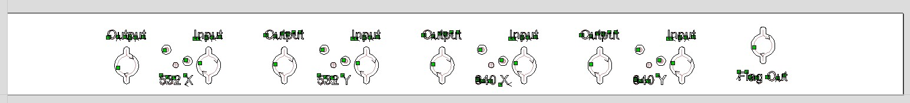
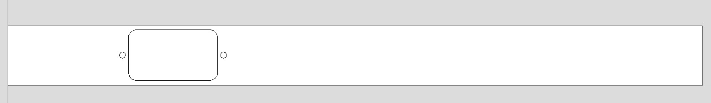
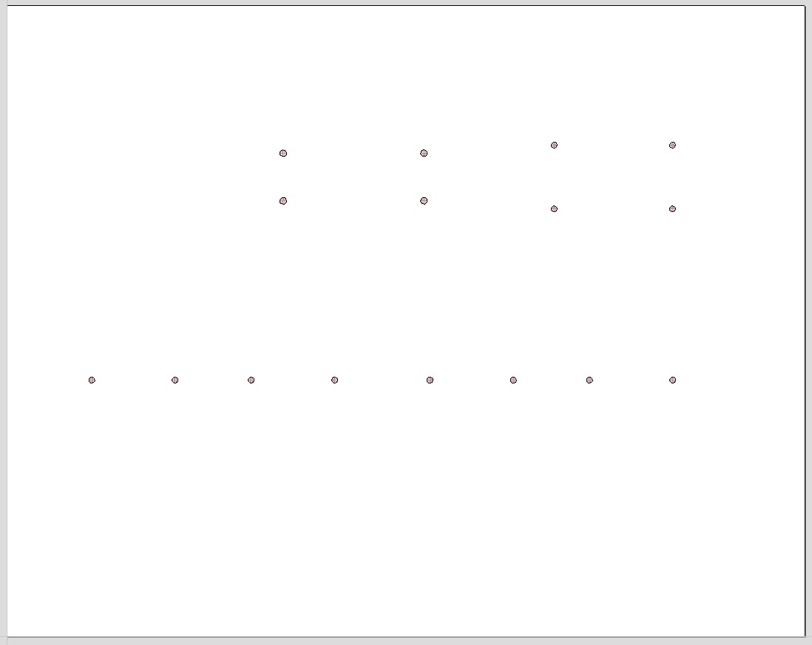

# Rack-mount box design
The CNC design is made with Cut2D software. The material is the front panel, back panel, and bottom of Cheval's HS19AL1UD2 rack mount box.

## Front panel

The front panel contains the connection ports for 4 main boards, with apertures for buttons, trimpots, and LEDs. There is an additional port on the right for the fault handler board.

## Back panel

The back panel is cut to fit the AC power connector (Schurter DD12.9111.111).

## Bottom Plate

The bottom panel contains a series of through-holes for screws. The 8 holes on the upper half of the plate are left for mounting the AC-DC adapter (XP Power ECL15US05-S) and the power board. The 8 holes below are for the installation of ZLPF-120+ low-pass filters.